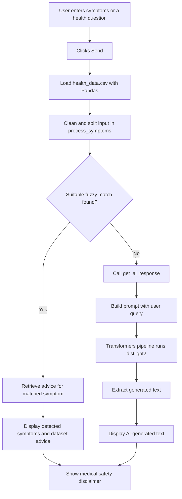
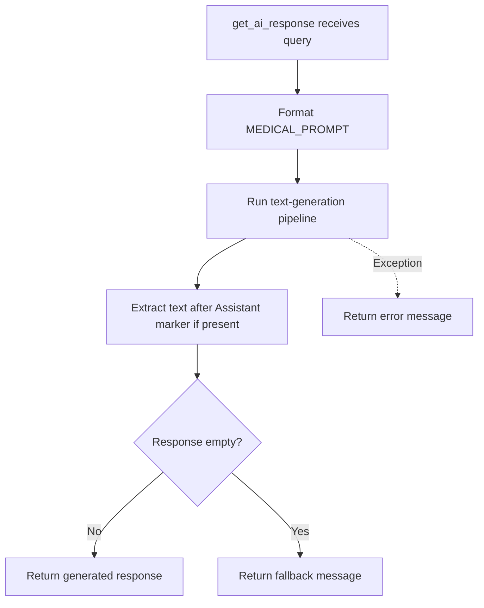
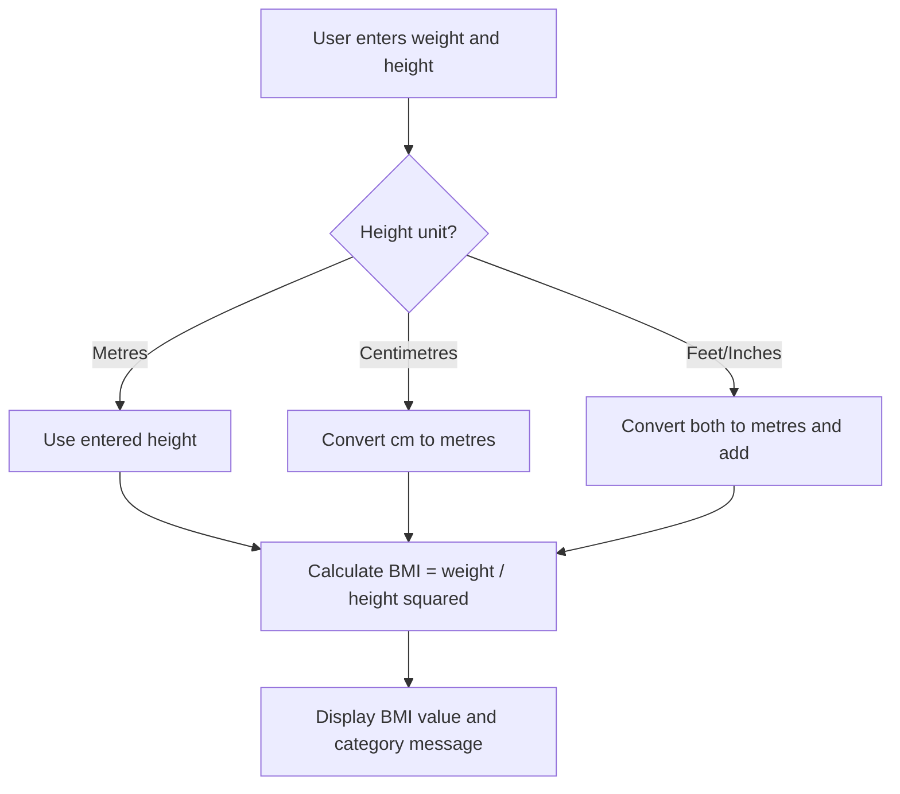

# AI Health Assistant

A Python and Streamlit application that lets users enter symptoms or health-related questions, looks for matching symptoms in a predefined CSV dataset, and falls back to a pretrained text-generation model when no suitable dataset match is found. The app also includes a BMI calculator.

> **Safety note:** This is an educational project, not a medical device. Dataset advice and AI-generated text may be inaccurate. It must not be used to diagnose, treat, or rule out a medical condition. Seek a qualified healthcare professional for medical concerns.

## Live Demo

- **Application:** https://sympai.streamlit.app/
- **GitHub repository:** https://github.com/M-Codes6/AI-Powered-Health-Assistant

## Project Background

This project was developed as part of the **AICTE Internship on AI: Transformative Learning with TechSaksham**, a joint CSR initiative by Microsoft and SAP, as stated in the original project documentation.

## Features

- **Symptom matching:** Cleans and splits user input, then uses fuzzy string matching to compare each symptom with names in the CSV dataset.
- **Dataset-based advice:** When a match is found, retrieves the corresponding advice from `health_data.csv`.
- **Text-generation fallback:** If the symptom-matching route does not provide a usable match, calls a Hugging Face Transformers text-generation pipeline using `distilgpt2`.
- **BMI calculator:** Accepts weight and height in metres, centimetres, or feet/inches; converts height to metres and calculates BMI as weight (kg) / height (m)².
- **Streamlit interface:** Provides the text input, response display, loading indicator, and BMI controls.

## Application Flow

The following flowchart reflects the control flow visible in `main.py`, `symptom_processor.py`, and `models.py`.



### Text-generation fallback flow



### BMI calculator flow



## Project Structure

```text
AI-Powered-Health-Assistant/
├── app.py                  # Welcome page and Get Started link
├── main.py                 # Symptom input, dataset lookup, fallback, BMI calculator
├── health_data.csv         # Predefined symptom/advice dataset
├── models.py               # Pretrained text-generation pipeline
├── symptom_processor.py    # Input cleanup, fuzzy matching, advice lookup
├── requirements.txt        # Python dependencies
└── README.md
```

## Technologies

| Technology | Role in this project |
|---|---|
| Python | Application logic |
| Streamlit | Web interface |
| Pandas | Loads and queries the CSV dataset |
| `fuzzywuzzy` | Approximate string matching for symptom names |
| `re` | Cleans and splits input text |
| Hugging Face Transformers | Provides the text-generation pipeline |
| `distilgpt2` | Pretrained general-purpose text-generation model used in fallback |
| PyTorch (`torch`) | Model execution support and CUDA availability check |
| `python-Levenshtein` | Supporting dependency for string matching |
| NumPy | Listed in dependencies; no direct use identified in the supplied Python files |

## How It Works

1. The user enters symptoms or a health-related question and clicks **Send**.
2. `main.py` loads `health_data.csv` using `pandas.read_csv`.
3. `process_symptoms()` removes characters outside letters, commas, and spaces, converts text to lowercase, and splits input into symptom fragments.
4. Each fragment is compared with the dataset's `Symptom` column using fuzzy matching with a score cutoff of 75.
5. If a match is found, the corresponding `Advice` value is retrieved and displayed.
6. If no suitable dataset advice is returned, `get_ai_response()` builds a prompt and calls a Transformers text-generation pipeline using `distilgpt2`.
7. The generated text is extracted and displayed in the Streamlit interface.

## BMI Calculation

The application calculates:

**BMI = weight in kilograms / (height in metres × height in metres)**

Height can be entered in metres, centimetres, or feet/inches. This is a formula-based calculator, not a machine-learning prediction.

## Installation

### 1. Clone the repository

```bash
git clone https://github.com/M-Codes6/AI-Powered-Health-Assistant.git
cd AI-Powered-Health-Assistant
```

### 2. Create and activate a virtual environment

**Windows (PowerShell):**

```powershell
python -m venv myenv
.\myenv\Scripts\Activate.ps1
```

**macOS/Linux:**

```bash
python -m venv myenv
source myenv/bin/activate
```

### 3. Install dependencies

```bash
pip install -r requirements.txt
```

### 4. Run the app

```bash
streamlit run app.py
```

If the deployment uses a separate page for the main interface, the app's **Get Started** link navigates to that page.

## Limitations and Safety

- `distilgpt2` is a general-purpose text-generation model, not a medically validated diagnostic model.
- A fuzzy text match identifies similar wording; it does not verify a medical condition.
- Dataset-based advice depends on the content and quality of `health_data.csv`.
- Generated output can be incorrect, incomplete, or inappropriate for a user's circumstances.
- The app's disclaimer advises users to consult a medical professional for serious concerns. Do not rely on this app for diagnosis, treatment decisions, or emergencies.
- The code loads the generation pipeline inside `get_ai_response()`, so it may reload the model each time the fallback is used.

## Acknowledgements

Developed as part of the AICTE Internship on AI: Transformative Learning with TechSaksham, a joint CSR initiative by Microsoft and SAP, according to the original project documentation.

## License

The original README states that the project uses the MIT License. Check that the repository includes the corresponding `LICENSE` file before relying on this statement.
